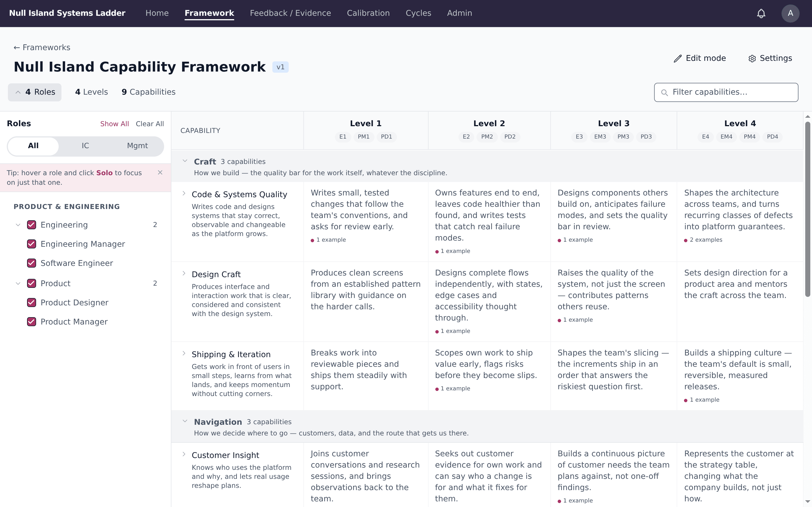
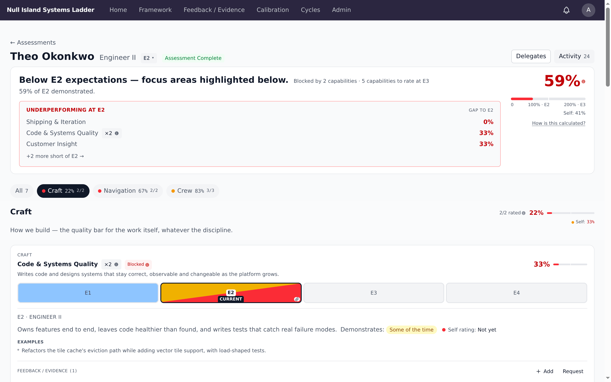
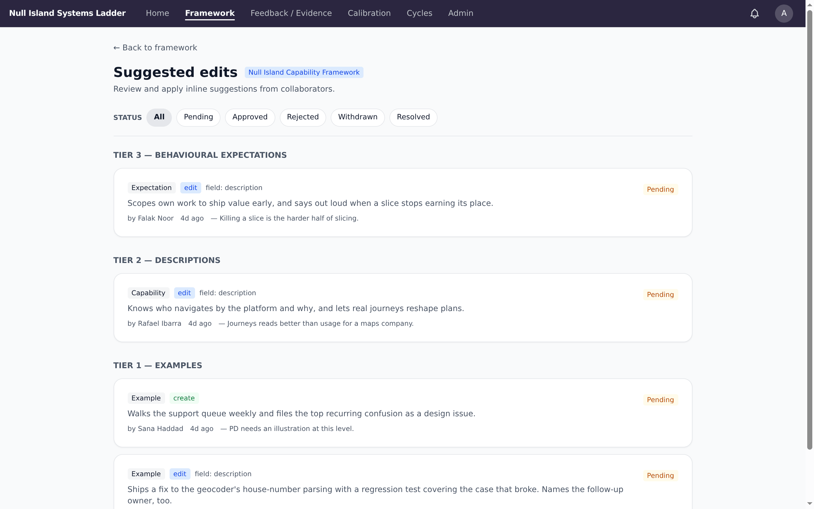
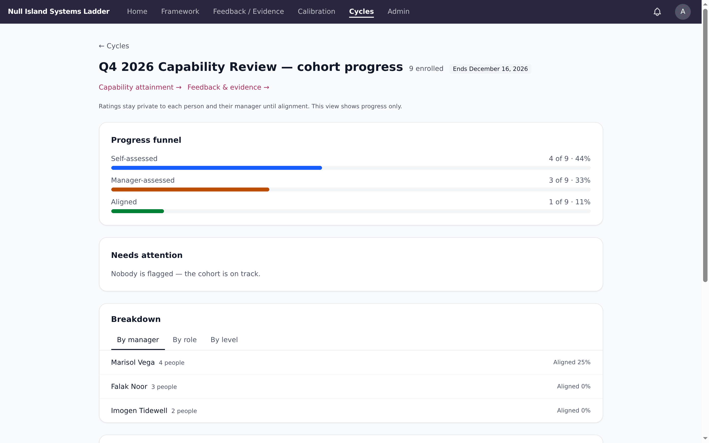

# Espalia

Espalia is an open-source, multi-tenant platform for operationalising career
growth frameworks — and, over time, for capability-based team planning built
on the same foundations. Organisations define their career paths (role
families, roles, levels, capabilities, behavioural expectations) and use the
platform to run self-assessments, manager alignment conversations, evidence
collection and growth planning.

The name comes from *espalier*: a plant trained up a frame, tier by tier.

The platform embodies a simple philosophy: performance is multi-dimensional,
and culture is the sum of consistently demonstrated behaviours. A career path
is three things at once — a cultural blueprint (what behaviours to reward), a
performance map (what good looks like at each level) and a development roadmap
(how to grow within or across roles).



*The framework explorer: what each capability looks like at every level, for
the roles you choose to see.*

## What it does

- **Framework authoring** — roles, levels, capabilities and behavioural
  expectations, edited collaboratively with inline suggested edits (Google
  Docs style), versioned with draft/publish semantics, and migrated safely
  when the framework's shape changes. The full history is event-sourced.
- **Assessments** — self-ratings and manager ratings against the framework,
  alignment conversations that formalise agreement, and assessment cycles that
  run a cohort through the process with progress tracking.
- **Evidence** — collected continuously, linked to capabilities, requested
  from peers, and carried across framework versions.
- **Growth planning** — focus areas, growth plans and check-ins on each
  person's development stream.
- **Calibration** — sessions that put ratings side by side and capture notes,
  flags and revisit requests.
- **Reporting** — capability attainment, evidence coverage, cycle cohort
  views and promotion-readiness signals.
- **MCP server** — the same operations that power the web UI are exposed over
  the [Model Context Protocol](https://modelcontextprotocol.io), with OAuth,
  so AI assistants can read and write frameworks, assessments and evidence on
  a person's behalf. Importing an existing framework via MCP is the documented
  onboarding path: [docs/import-your-framework.md](docs/import-your-framework.md).
- **Integrations** — HRIS sync (HiBob today; adapter pattern for others),
  Slack notifications and feedback capture, a signed feedback exchange with
  peer systems, and optional AI assistance. All credentials are tenant-level,
  entered through the UI and encrypted at rest.

## A look around

Every screenshot in this README shows **Null Island Systems**, the fictional
tenant that `bin/setup` seeds — the people, ratings and suggestions are all
invented. The navbar reads "Ladder" because the demo tenant brands its own
instance, as any tenant can.



*An assessment scores each capability against the person's level, names what
blocks the level, and keeps the self and manager perspectives side by side.*



*Frameworks are edited collaboratively: anyone can suggest an edit inline,
and reviewers apply them tier by tier — examples lightly, canonical
expectations with more care.*



*An assessment cycle tracks its cohort from self-assessment through manager
assessment to alignment, without exposing anyone's ratings early.*

## Technology

Rails 8 on PostgreSQL, with [RailsEventStore](https://railseventstore.org)
for the event-sourced domains, Hotwire (Turbo + Stimulus with import maps),
Phlex views and components, TailwindCSS v4, Solid Queue/Cache/Cable, Devise
and Pundit. No Node.js dependency.

[AGENTS.md](AGENTS.md) holds the architecture overview and the engineering
conventions; [docs/](docs/) holds the design documents and per-layer guides.

## Getting started

Requires Ruby (see [.ruby-version](.ruby-version)) and PostgreSQL — or use
the included devcontainer, which provides both plus a browser for system
tests.

```bash
bin/setup   # dependencies, database, seeds
bin/dev     # http://localhost:6600
```

Seeding creates **Null Island Systems**, a fictional example tenant with a
published engineering + product framework, an org chart, an assessment cycle
in flight, evidence and suggested edits — enough to explore every feature. In
development you can sign in as the seeded admin (`admin@example.com`) or as
seeded people like `marisol@nullisland.example` (manager) and
`theo@nullisland.example` (engineer) — the development password is
`password123` throughout.

To bring in your organisation's real framework, follow
[docs/import-your-framework.md](docs/import-your-framework.md).

```bash
bin/rails test                   # the suite
bin/rails development:precommit  # lint + security + full suite; the PR gate
```

## Deployment

Espalia runs standalone: the Rails app, PostgreSQL and Solid Queue — no other
services required. A [render.yaml](render.yaml) blueprint is included for
[Render](https://render.com); any host that runs Rails and Postgres works.
A tenant can sign in at its own domain or subdomain: set it under **Tenant
admin → Theme**, point its DNS at the instance and add the domain to your
host's TLS. Requests arriving on it carry that tenant's branding and scope
the session to it. If Google sign-in is configured, also register the custom
domain's callback (`https://<domain>/users/auth/google_oauth2/callback`) as
an authorised redirect URI in the Google Cloud console, or the Google button
fails on that domain.

Bootstrap the first admin with `SEED_ADMIN_EMAIL` / `SEED_ADMIN_PASSWORD` —
seeds run automatically when the database is first created, so on an existing
database run `bin/rails db:seed` with those set. Or create one directly with
`EMAIL=you@example.com bin/rails admin:create` — that task also reads
`PASSWORD` from the environment when it creates a new user, so export it
rather than typing it into the command line. Configure integrations per
tenant through the UI once signed in.

## Theming

An organisation's admin picks a theme under **Tenant admin → Theme**:

- **Default**, the standard look.
- **Bento**, a complete preset with its own colours and font.
- **Custom**, Default with the organisation's own brand colour, navbar colour
  and font. Each colour has a light and a dark value, and the platform picks
  the text that goes on it, so it always stays readable.

Each person chooses Auto, Light or Dark under **Appearance** in the user menu.

To build a screen, start with
[the component catalogue](app/components/README.md); to build or change
anything with colour, read
[the theming guide](docs/guidelines/theming.md).

## Contributing

See [CONTRIBUTING.md](CONTRIBUTING.md). Security reports go to
**security@espalia.app**, not the issue tracker — see
[SECURITY.md](SECURITY.md).

## History and license

Espalia began life as **GrowthOS**, the internal growth platform at
[me&u](https://www.meandu.com); you'll still see that name in places until the
product name becomes configurable. MIT-licensed — see [LICENSE](LICENSE).
The Espalia name and mark are trademarked separately and not granted by the
license.
