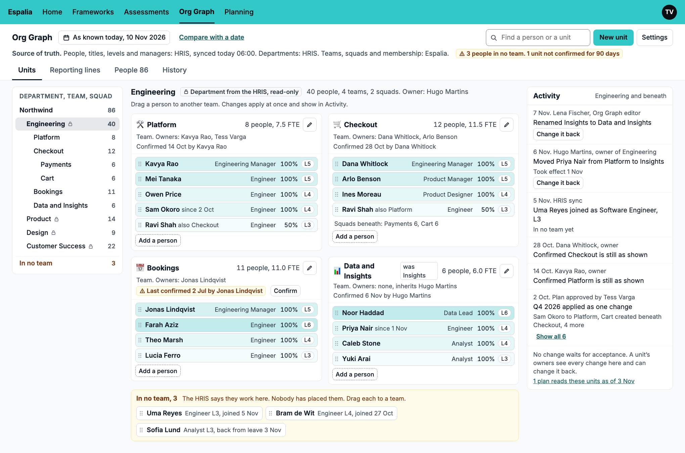
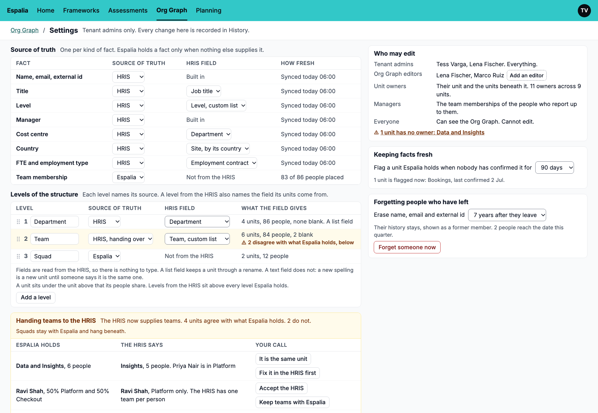
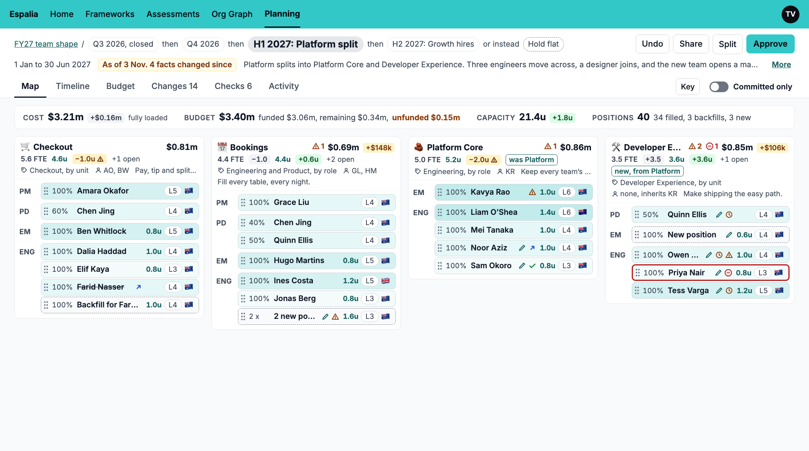

# Team Planning and the Org Graph

> Status: proposal. Nothing here is built.

Team Planning lets an organisation explore how its teams could be shaped: who works on
what, at what cost and with how much capacity, across scenarios. It reads the
organisation as it is known from the Org Graph, which Espalia does not have yet. The Org
Graph is built first.

## Read in this order

| Document | What it says |
|---|---|
| [Team Planning, module description](team-planning.md) | What a planner can do, and the two principles everything else follows. |
| [Team Planning, data design](team-planning-design.md) | How a plan is held: one event-sourced aggregate, scenarios as changes, budget, approval. |
| [Org Graph, design](org-graph-design.md) | People, teams and reporting lines with their history, and where each fact comes from. |
| [Shreddable event fields, design](shreddable-fields-design.md) | How an immutable event can hold a value that must be forgettable. |
| [Org Graph, implementation plan](org-graph-plan.md) | Epics, stories and their dependencies. |

Team Planning has no implementation plan yet. It follows once the Org Graph is under
way.

## Mockups

The mockups show the intent of each screen. They are not specifications: where a mockup
and a design disagree, the design is right and the mockup is out of date. Every person,
team and figure in them is invented.

### Team Planning

| Screen | Shows |
|---|---|
| [Map](mockups/01-map.png) | A scenario as teams, positions and people, with what it changes marked. |
| [Person and position sheet](mockups/02-person-and-position-sheet.png) | One person in a scenario: placement, cost, budget line, capacity, and what is known. |
| [Checks](mockups/03-checks.png) | What must be settled before approval, and the warnings. |
| [Timeline](mockups/04-timeline.png) | Scenarios along the calendar, following teams and people. |
| [Plan and scenarios](mockups/05-plan-and-scenarios.png) | A plan's scenarios, its rules, the data it holds and its members. |
| [Budget](mockups/06-budget.png) | Approved, funded, remaining and unfunded, by cost centre and by budget line. |
| [Keep up with reality](mockups/07-keep-up-with-reality.png) | What changed in the Org Graph since the plan last read it. |
| [Split, approve and carry out](mockups/08-split-approve-carry-out.png) | Approving part of a scenario, and raising its changes in other systems. |

### Org Graph

| Screen | Shows |
|---|---|
| [Org Graph](mockups/09-org-graph.png) | Units and their members, people in no team, and recent activity. |
| [Edit a unit](mockups/10-edit-a-unit.png) | A unit's name, parent, owners and members, with an effective date. |
| [Person in the Org Graph](mockups/11-person-in-the-org-graph.png) | A person's teams, their HRIS facts read-only, and their history. |
| [Org Graph settings](mockups/12-org-graph-settings.png) | The source of truth and HRIS field for each fact and each level of the structure. |

