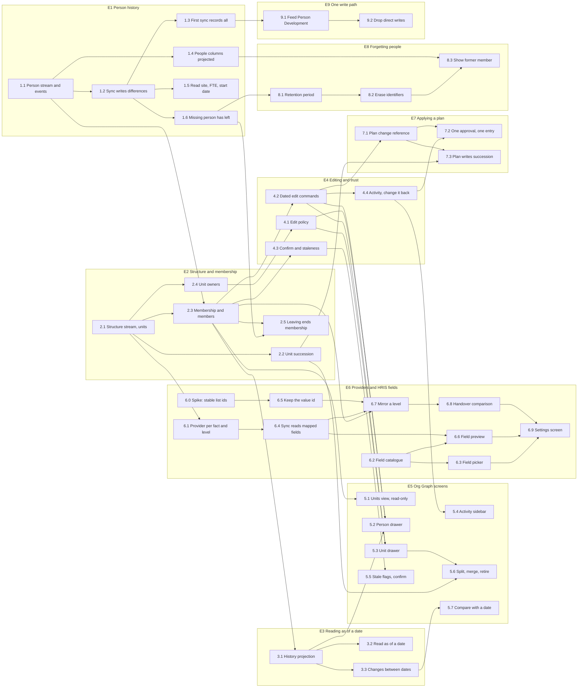

# Org Graph — implementation plan

> Status: proposal. Nothing here is built. Read [the design](org-graph-design.md) first.
> This page orders the work. It has no sizes: nobody has estimated it.

The plan has nine epics and 43 stories. A story names the stories it needs. Four need
nothing and can start together: 1.1, 2.1, 6.0 and 6.2.

## Epics

| # | Epic | Needs | Delivers |
|---|---|---|---|
| E1 | Person history | none | Every HRIS fact about a person is an event with a date |
| E2 | Structure and membership | E1 | Units, owners, and who is in what |
| E3 | Reading as of a date | E1, E2 | "As known on" reads, and the changes between two dates |
| E4 | Editing and trust | E2 | Who may edit, effective dates, confirm, change it back |
| E5 | Org Graph screens | E2, then E3 and E4 per screen | The Org Graph, the unit drawer and the person drawer |
| E6 | Providers and HRIS fields | E2 | The settings screen, and levels mirrored from the HRIS |
| E7 | Applying a plan | E2, E4 | The interface Team Planning calls on approval |
| E8 | Forgetting people | E1 | Retention and identifier erasure |
| E9 | One write path | E1 stable in production | Person Development fed from the Org Graph |

E1, E2 and E3 run in sequence. After E2, three tracks can run side by side: E4 with E5,
E6, and E8.

E1 alone is worth shipping. It changes nothing a user sees, and it starts the history.
History that was never recorded cannot be rebuilt later.

## Dependencies

An arrow runs from a story to a story that needs it. A dependency another one already
implies is not drawn: 3.1 needs 1.1, and the path to it runs through 2.3.

The longest chain is six stories and ends at the settings screen (6.9). The HRIS field
work sets the length of the plan.

## Stories

### E1 Person history

| # | Story | Needs |
|---|---|---|
| 1.1 | Person stream and its events, each with provider and effective date | none |
| 1.2 | Sync compares each row with the current projection and writes only differences | 1.1 |
| 1.3 | First sync writes `PersonRecorded` for everyone | 1.2 |
| 1.4 | Non-identifier `people` columns become a projection of the stream | 1.1 |
| 1.5 | Sync brings in site and country, FTE and employment type, and start date | 1.2 |
| 1.6 | A person missing from the HRIS gets `PersonLeft` | 1.2 |

### E2 Structure and membership

| # | Story | Needs |
|---|---|---|
| 2.1 | Structure stream: taxonomy, unit created, renamed, moved, retired, with provider and external reference | none |
| 2.2 | `UnitSucceeded` for splits, merges and replacements | 2.1 |
| 2.3 | Membership events in the person stream, and a unit members projection | 1.1, 2.1 |
| 2.4 | Owners: add, remove, inherit from parent, flag a unit with none | 2.1 |
| 2.5 | Leaving ends memberships on the leaving date | 1.6, 2.3 |

### E3 Reading as of a date

| # | Story | Needs |
|---|---|---|
| 3.1 | History projection with both times, effective and learned | 1.1, 2.3 |
| 3.2 | `as_of` for roster and structure | 3.1 |
| 3.3 | `changes_between` | 3.1 |

### E4 Editing and trust

| # | Story | Needs |
|---|---|---|
| 4.1 | Edit policy: tenant admin, Org Graph editor role, unit owners, manager chain for memberships | 2.4 |
| 4.2 | Membership and unit commands take an effective date and refuse facts another provider holds | 2.3 |
| 4.3 | `FactConfirmed`, and a staleness threshold per tenant | 2.3 |
| 4.4 | Activity feed per unit, with change it back | 4.2 |

### E5 Org Graph screens

| # | Story | Needs |
|---|---|---|
| 5.1 | Units view, read-only, with the "in no team" tray | 2.3 |
| 5.2 | Person drawer: teams editable, employment read-only, history | 4.1, 4.2, 3.1 |
| 5.3 | Unit drawer: name, parent, owners, members | 4.1, 4.2 |
| 5.4 | Activity sidebar | 4.4 |
| 5.5 | Stale flags and confirm buttons | 4.3 |
| 5.6 | Split, merge and retire from the unit drawer | 2.2, 5.3 |
| 5.7 | Compare with a date | 3.3 |

### E6 Providers and HRIS fields

| # | Story | Needs |
|---|---|---|
| 6.0 | Spike: confirm HiBob's stored value for a list field is a stable id | none |
| 6.1 | Provider setting per fact and per taxonomy level | 2.1 |
| 6.2 | Adapter exposes the field catalogue and named lists | none |
| 6.3 | Field picker replaces the pasted level id, and migrates the existing setting | 6.2 |
| 6.4 | Sync requests the fields the tenant's mapping names | 6.1 |
| 6.5 | Mapper keeps the value id beside the display text | 6.0 |
| 6.6 | Field preview: units, people, blanks | 6.2, 6.4 |
| 6.7 | Mirror a level from a field: units, renames, membership, parent from shared people | 2.3, 6.4, 6.5 |
| 6.8 | Handover: compare with what Espalia holds and list disagreements | 6.7 |
| 6.9 | Settings screen | 6.3, 6.6, 6.8 |

### E7 Applying a plan

| # | Story | Needs |
|---|---|---|
| 7.1 | Commands accept a reference to the plan change they came from | 4.2 |
| 7.2 | Events from one approval share a cause, and the activity feed shows them as one | 7.1, 4.4 |
| 7.3 | Applying a split or merge writes `UnitSucceeded` | 2.2, 7.1 |

### E8 Forgetting people

| # | Story | Needs |
|---|---|---|
| 8.1 | Retention period per tenant, default seven years | 1.6 |
| 8.2 | Erase identifiers and write `PersonForgotten`, on schedule or on request | 8.1 |
| 8.3 | Projections and screens show a former member | 8.2, 1.4 |

### E9 One write path

| # | Story | Needs |
|---|---|---|
| 9.1 | Handler on Org Graph events applies the title mapping and issues Person Development commands | E1 stable in production |
| 9.2 | Remove the sync's direct Person Development writes | 9.1 |

## Open decisions

- **Stable ids (6.0).** The design assumes HiBob's stored value for a list field stays
  the same when its label changes. Nobody has confirmed it. If it does not, 6.5 is
  dropped and every rename in the HRIS becomes a stated succession.
- **Split parents (6.7).** A unit whose people sit under two different units at the
  level above has no single parent to read. The likely answer is to list it for someone
  to resolve.
- **Structure editing (5.3, 5.6).** The design leaves a full editing screen for structure
  out of a first version, because a first plan applied whole creates the structure. 5.3
  is small enough to keep. 5.6 can wait.
