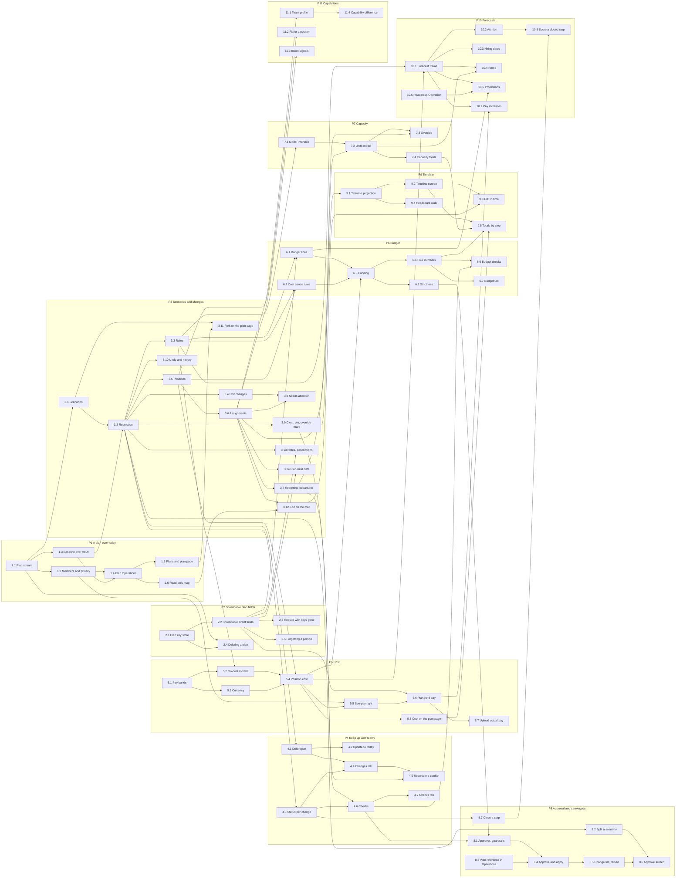

# Team Planning implementation plan

> Status: approved on 14 Nov 2026. Nothing here is built yet. Read [the module description](team-planning.md)
> and [the data design](team-planning-design.md) first. This page orders the work. It has
> no sizes: nobody has estimated it.

The plan has eleven epics and 75 stories. A story names the stories it needs. Five need
nothing and can start together: 1.1, 2.1, 5.1, 8.3 and 10.5.

Every story ships its own Operation, so a planner can do through an MCP client what the
story adds to the web. A story that adds only a screen reuses an Operation an earlier
story shipped.

## The Org Graph it stands on

The Org Graph side of every seam is built. Each story below names the reader or command
it uses. The ones planning leans on most:

| Need | Built as |
|---|---|
| The organisation on a date (R4) | `OrgGraph::AsOf`: people, live units and memberships as known on a date, with each person's cost centre, site, country, FTE and employment type, and each membership's allocation and role |
| What changed between two dates (R4) | `OrgGraph::ChangesBetween`, by effective or learned date. A change carries its `event_id`, not its plan or cause |
| History with both times | The history projection, `org_fact_periods` |
| Who holds a fact (R5) | `OrgFactProvider`, and the refusal in `CommandHandler#ensure_provides!` |
| Applying a change (R6) | The person and structure command handlers. Every command takes `effective_on:`, `plan_id:` and `plan_change_id:`, and a handler built with `cause_id:` stamps it on every event it writes |
| Splits and merges | `StructureCommandHandler#apply_succession`, one transaction |
| Who may change what | `OrgGraphPolicy`: `edit_unit?`, `edit_membership?`, `record_succession?` |
| A plan's changes in the activity feed | `OrgUnitActivity::Group` groups by cause and shows "From plan" |
| Forgetting a person (R7) | `OrgGraph::Forgetting`, which writes `PersonForgotten` |

Three limits shape the plan. `AsOf` takes a date, not an instant (see decision 3). A
`ChangesBetween` change reaches its plan only through its event. And no Operation yet
passes a plan reference to the handlers, so 8.3 adds that path.

## Epics

| # | Epic | Needs | A user can | Mockup |
|---|---|---|---|---|
| [P1](https://github.com/espaliahq/espalia/issues/179) | A plan over today | none | Open a private plan, name its members, and see the organisation on a date as a map | [05](mockups/05-plan-and-scenarios.png), [01](mockups/01-map.png) |
| [P2](https://github.com/espaliahq/espalia/issues/180) | Shreddable plan fields | none | Trust that deleting a plan, or forgetting a person, makes what a plan held unreadable | none |
| [P3](https://github.com/espaliahq/espalia/issues/181) | Scenarios and changes | P1 | Fork scenarios and reshape teams on the map: units, positions, placements, reporting lines, departures | [01](mockups/01-map.png), [02](mockups/02-person-and-position-sheet.png) |
| [P4](https://github.com/espaliahq/espalia/issues/182) | Keep up with reality | P3 | See what moved in the Org Graph, update the plan to today, and see each change as done, pending or conflicting | [07](mockups/07-keep-up-with-reality.png), [03](mockups/03-checks.png) |
| [P5](https://github.com/espaliahq/espalia/issues/183) | Cost | P3 | Price a scenario from pay bands, or from actual pay uploaded into the plan | [02](mockups/02-person-and-position-sheet.png) |
| [P6](https://github.com/espaliahq/espalia/issues/184) | Budget | P5 | See approved, funded, remaining and unfunded, by cost centre and budget line | [06](mockups/06-budget.png) |
| [P7](https://github.com/espaliahq/espalia/issues/185) | Capacity | P3 | See what each team can deliver, with each person's working | [01](mockups/01-map.png) |
| [P8](https://github.com/espaliahq/espalia/issues/186) | Approval and carrying out | P4, P6 | Approve a scenario, apply what Espalia holds, and hand over the rest as a change list | [08](mockups/08-split-approve-carry-out.png) |
| [P9](https://github.com/espaliahq/espalia/issues/187) | Timeline | P3 | Read a path of scenarios along the calendar, with the headcount walk | [04](mockups/04-timeline.png) |
| [P10](https://github.com/espaliahq/espalia/issues/188) | Forecasts | P5 | See attrition, hiring dates and ramp as forecast rows, kept apart from what was decided | [06](mockups/06-budget.png) |
| [P11](https://github.com/espaliahq/espalia/issues/189) | Capabilities in the plan | P3 | See each team's depth and each person's fit for an open position | [02](mockups/02-person-and-position-sheet.png) |

### The first release: planning without money

P1, P3 and P4 are a usable product on their own. A planner opens a plan, shapes
scenarios on the map, and keeps them true to the organisation as it moves. Nothing in it
holds pay, so it waits on no decision about pay.

P2 does not gate it. P2 gates only what can name a person or hold their pay: notes,
scenario descriptions, plan-held values and planned promotions (3.13, 3.14), and
everything with money in it (5.6 onward, and P6). The first release can ship without
notes and add them when P2 lands.

After P3, three tracks run side by side: P5 then P6, P7, and P9. Capacity needs no pay, so
P7 never waits for cost.

## Dependencies

An arrow runs from a story to a story that needs it. A dependency another one already
implies is not drawn.

The longest chain is twelve stories and ends at the approve screen (8.6): 1.1, 3.1, 3.2,
3.3, 5.2, 5.4, 6.3, 6.5, 8.1, 8.4, 8.5, 8.6. Cost and budget set the length of the plan,
because a binding budget guardrail needs them.

## Stories

### P1 A plan over today

| # | Story | Needs |
|---|---|---|
| 1.1 | Plan stream `tenant-{id}/Plan-{plan_id}` through `EventStreamNaming`: `PlanCreated` with name and base date, `PlanRenamed`, `PlanDeleted` | none |
| 1.2 | Members as editor or viewer, `PlanMemberAdded` and `PlanMemberRemoved`, and a `PlanPolicy` under which a tenant admin does not open someone else's plan. A planner role, given by a tenant admin, may create a plan (decision 7) | 1.1 |
| 1.3 | Baseline reader: the root scenario resolved over `OrgGraph::AsOf` on the plan's base date, joined to names, with "Former member" for anyone forgotten | 1.1 |
| 1.4 | Operations: list, create, get, rename and delete a plan, its members, and the baseline map | 1.2, 1.3 |
| 1.5 | Plans index and the plan page: scenarios, rules and members, with the baseline row read-only | 1.4 |
| 1.6 | Read-only map of the baseline: units, people with their allocation and role from `AsOf::Membership`, and the Unassigned bucket | 1.4 |

### P2 Shreddable plan fields

Built from [the shreddable fields design](shreddable-fields-design.md). Nothing of it is
on main yet.

| # | Story | Needs |
|---|---|---|
| 2.1 | Key store: a key per plan, and one per person within a plan, to encrypt a field, decrypt it, and destroy the key | none |
| 2.2 | Shreddable fields on events, and the aggregate guard: an aggregate never decides on a shreddable value | 2.1 |
| 2.3 | Projections rebuild with keys destroyed, showing a value as removed | 2.2 |
| 2.4 | `PlanDeleted` destroys the plan's keys | 1.1, 2.1 |
| 2.5 | A handler on `PersonForgotten` destroys that person's key in every plan at once (decision 6) | 2.2 |

### P3 Scenarios and changes

| # | Story | Needs |
|---|---|---|
| 3.1 | Scenarios: `ScenarioForked` with parent, `then` or `instead` and period, `ScenarioPeriodSet`, `ScenarioRemoved`. Periods along a path are contiguous | 1.1 |
| 3.2 | Resolution: the base, then each scenario's changes down the chain, last change per subject and facet. End-state changes to different facets retry on a version conflict | 3.1, 1.3 |
| 3.3 | Rules: `RuleSet` with tenant defaults, resolved down the chain like any change | 3.2 |
| 3.4 | Unit changes: `UnitSet`, `UnitRetired`, `UnitSuccessionSet`, with ids the plan mints | 3.2 |
| 3.5 | Positions: `PositionSet` (role and level from the framework, unit, FTE, backfill or new) and `PositionClosed` | 3.2 |
| 3.6 | Assignments: `AssignmentSet` places a person in a position or unit with an allocation. The Unassigned bucket is derived | 3.5 |
| 3.7 | `ReportingLineSet`, and `DepartureSet` with its linked position | 3.6 |
| 3.8 | A change that no longer fits still resolves, and is marked as needing attention | 3.4, 3.6 |
| 3.9 | `ChangeCleared` and `ChangePinned`, and the overrides projection behind the one override mark | 3.2 |
| 3.10 | `ChangeUndone` and `ChangeRedone`, and a scenario's history with who made each change | 3.2 |
| 3.11 | Fork, rename and switch scenarios from the plan page | 3.1, 1.5 |
| 3.12 | Edit on the map: drag a person or position, drop on the Unassigned bucket, set allocation as they land | 3.6, 1.6 |
| 3.13 | Notes on changes and `ScenarioDescribed`, shreddable under the plan key | 3.2, 2.2 |
| 3.14 | `PlanDataSet` for a corrected level or FTE and a placeholder hire, and `LevelSet` for a planned promotion, each shreddable under the person's key | 3.6, 2.2 |

### P4 Keep up with reality

| # | Story | Needs |
|---|---|---|
| 4.1 | Drift report from `OrgGraph::ChangesBetween` by learned date since the base, each change with what it does to the plan | 3.2 |
| 4.2 | Update to today: `PlanRebased` moves the base. Nothing else is rewritten | 4.1 |
| 4.3 | Status per change, done, pending or conflicting, by comparing its end state with `OrgGraph::AsOf` today | 3.2 |
| 4.4 | Changes tab: drift and planned changes, each with its source of truth from `OrgFactProvider`. An Org Graph change that came from this plan is matched through its event's `plan_id` | 4.1, 4.3 |
| 4.5 | Reconcile a conflict: keep the plan (pin) or follow reality (clear) | 4.4, 3.9 |
| 4.6 | Checks projection: over- or under-allocated, placed nowhere, placed but left, no manager, a manager sharing no unit | 3.7, 4.3 |
| 4.7 | Checks tab, with guardrail checks marked | 4.6 |

### P5 Cost

| # | Story | Needs |
|---|---|---|
| 5.1 | Pay bands as tenant configuration: role and level from the framework, location, currency. Held by tenant admins | none |
| 5.2 | On-cost models (flat, by country, itemised) as rules with a tenant default | 5.1, 3.3 |
| 5.3 | Exchange rates and a reference currency, applied once at report time | 5.1 |
| 5.4 | Position cost for the part of the period it exists, priced at band midpoint, rolled up by unit and cost centre, against the baseline. It must answer one question: editing a pay band changes what existing plans cost, so does a plan reprice live, or price a scenario at the bands as they stood on a date? | 5.2, 5.3, 3.5 |
| 5.5 | The see-pay right per plan member. Without it, band midpoints only | 5.4, 1.2 |
| 5.6 | Plan-held pay: `PlanDataSet` for a person's actual cost, shreddable under their key | 5.5, 2.2 |
| 5.7 | Upload actual pay from a file into one plan: match people by Org Graph id or email, preview the matches and blanks, write plan-held values. Never written to the Org Graph | 5.6 |
| 5.8 | Cost on the plan page and the map, with the difference from the baseline | 5.4 |

### P6 Budget

| # | Story | Needs |
|---|---|---|
| 6.1 | Budget lines: `BudgetLineSet` and `BudgetLineCut`, amounts shreddable, the tenant's approved budget as the root's default | 2.2, 3.3 |
| 6.2 | Cost centre rules: an ordered list of matchers. A filled position takes its person's cost centre from `AsOf::Person` | 3.3, 3.5 |
| 6.3 | Funding: the most specific matching budget line, draw order, and `PositionFundingSet` for trades | 6.1, 6.2, 5.4 |
| 6.4 | Approved, funded, remaining and unfunded per unit and cost centre, with the basis stated | 6.3 |
| 6.5 | Strictness: position control, envelope, or the dimensions that must match | 6.3 |
| 6.6 | Budget checks: unfunded, mismatch, unplaced, ambiguous, variance, unused budget line | 6.4, 4.6 |
| 6.7 | Budget tab | 6.4 |

### P7 Capacity

| # | Story | Needs |
|---|---|---|
| 7.1 | Capacity model interface, chosen per role family and overridable per role, as a rule | 3.3 |
| 7.2 | The units model: a curve by level, and the cost of managing from the reporting graph | 7.1, 3.7 |
| 7.3 | Override a person's capacity in an assignment, with the calculated figure behind it | 7.2, 3.9 |
| 7.4 | Capacity per model, per unit and per scenario, each figure with its working, and the unclassified role check | 7.2 |

### P8 Approval and carrying out

| # | Story | Needs |
|---|---|---|
| 8.1 | The may-approve right, and tenant guardrails as rules that are binding at approval | 6.5, 4.6 |
| 8.2 | `ScenarioSplit`: move the agreed changes into a new scenario beneath, with what they overwrite, and name any change that blocks the split | 3.2 |
| 8.3 | Org Graph Operations accept a plan reference and a cause, and pass them to the handlers. A change made this way shows "From plan" in the activity feed | none |
| 8.4 | `PlanApproved` pins a point and applies every change Espalia holds, with `ChangeApplied` for each (see below) | 8.1, 8.3 |
| 8.5 | The change list Operation for an approved point, with a stable id per entry, and `ChangeRaised` with the upstream reference | 8.4 |
| 8.6 | Split, approve and carry out screen | 8.2, 8.5 |
| 8.7 | `StepClosed`: the next step stands on the Org Graph, pending changes show as carried over, and the closed step reads planned against actual through `AsOf` on its end date | 4.3 |

**One transaction.** 8.4 builds the person and structure handlers with the approval's
id as `cause_id`, and passes `plan_id` and `plan_change_id` on every command. Each kind
of change has one command:

| Change | Org Graph command |
|---|---|
| `UnitSet` | `create_unit`, `rename_unit` or `move_unit` |
| `UnitRetired` | `retire_unit` |
| `UnitSuccessionSet` | `apply_succession` |
| `AssignmentSet` | `set_membership`, `move_membership` or `end_membership` |
| `ReportingLineSet` | `change_manager` |
| `DepartureSet` | `leave` |
| `LevelSet` | `change_level` |

A change goes to a command only when Espalia holds its fact in `OrgFactProvider`. A
reporting line, a departure or a level the HRIS supplies goes on the change list (8.5)
instead. A position has no Org Graph fact: it stays in the plan, and a departure's
linked backfill stays open there. `PlanApproved`, every Org Graph event and every
`ChangeApplied` commit in one database transaction. The plan stream and the Org Graph
share an event store, so they land together or not at all. In the activity feed the
approval reads as one entry.

**A refusal fails the whole approval.** If the Org Graph refuses one change, nothing is
recorded: no `PlanApproved`, no Org Graph event, no `ChangeApplied`. The handlers refuse
when another provider holds the fact, when a unit has been retired or a person has left
since the base, or when the approver lacks edit rights on a unit. The plan stays as it
was and shows the refusal beside the change that caused it, in the Org Graph's words: for
example "HRIS supplies team membership; change it there". The planner updates to today or
edits the change, then approves again.

### P9 Timeline

| # | Story | Needs |
|---|---|---|
| 9.1 | Timeline projection: one path from the baseline to a leaf, with lanes and moves | 3.6 |
| 9.2 | Timeline screen, read-only, with a switch at each step that has alternatives | 9.1 |
| 9.3 | Edit in time: drag a person between blocks, drag a bar's end a step earlier or later | 9.2, 3.12 |
| 9.4 | Headcount walk: opening, hires, departures, transfers, closing, per step and unit | 9.1 |
| 9.5 | Cost against budget, unfunded and capacity under each column | 9.2, 5.8, 6.4, 7.4 |

### P10 Forecasts

| # | Story | Needs |
|---|---|---|
| 10.1 | Forecast frame: assumptions as rules, forecast rows per unit and step from a read model, and every total stating its actual, planned and forecast parts | 3.3, 5.4 |
| 10.2 | Attrition: a yearly rate, backfills kept open for the time to hire. Anyone with a `DepartureSet` is left out | 10.1 |
| 10.3 | Hiring status and target start on `PositionSet`, and a forecast start from the tenant's time to hire | 10.1 |
| 10.4 | Ramp: a new hire's capacity in their first steps | 10.1, 7.2 |
| 10.5 | An Operation for promotion readiness and place in band for a person on a date, as known at the end of the day before, from `PersonDevelopment::Scoring`, gated by `AssessmentPolicy#show?`; and the assessment changes recorded between two dates, for the drift report | none |
| 10.6 | Forecast promotions per unit and level, under the cohort minimum of `Reporting::CapabilityAttainment`, drawing on a pool | 10.1, 10.5, 6.1 |
| 10.7 | Pay increases: a flat rate, then movement toward each person's place in band | 10.1, 5.6 |
| 10.8 | A closed step shows its forecast beside what happened | 10.2, 8.7 |

### P11 Capabilities in the plan

| # | Story | Needs |
|---|---|---|
| 11.1 | Team profile per unit, under the cohort rule `Reporting::CapabilityAttainment` applies | 3.6 |
| 11.2 | Fit for an open position: people read against its role and level | 3.5 |
| 11.3 | Intent: explorations of another role and growth plan focus areas, beside the person | 3.6 |
| 11.4 | A scenario's capability difference from the baseline | 11.1 |

## Day one

Five stories need nothing: 1.1, 2.1, 5.1, 8.3 and 10.5. 10.5 sits outside the first
version (see below), so four are worth starting.

They can run as four lanes without touching the same files:

| Lane | Story | Where it works |
|---|---|---|
| 1 | 1.1 Plan stream | A new `app/contexts/team_planning/` |
| 2 | 2.1 Plan key store | A new key store model and its table |
| 3 | 5.1 Pay bands | A new tenant configuration model, its table, and an admin screen |
| 4 | 8.3 Plan reference in Operations | `app/operations/operations/org_graph/` and its tests |

Lanes 2 and 3 each add a migration, so each touches `db/schema.rb`. Whichever merges
second rebases and regenerates it. Nothing else is shared.

The second wave opens when 1.1 lands: 1.2, 1.3 and 3.1 can run together, and 2.2 joins
when 2.1 lands.

## Decisions

Tal decided all seven on 14 Nov 2026, each as recommended.

1. **Pay and benchmarks.** Decided: tenant admins enter pay bands, and actual pay can be
   uploaded into one plan from a file. Band midpoints are visible to every plan member.
   Band ranges and actual pay are visible only to members given the see-pay right.
   Uploaded pay lives in that plan alone and is never written to the Org Graph. An HRIS
   or payroll integration and a market benchmark feed wait. Shapes 5.1, 5.5 and 5.7.
2. **How a plan's changes are stored.** Decided: as events of the plan's own, each an end
   state for one subject, as designed. A diff against `AsOf` holds no intent, no note and
   no author, and cannot tell a change the Org Graph now matches from one never made.
   Shapes 3.2.
3. **What a plan stands on.** Decided: a date, as `AsOf` reads today, read as known at
   the end of the day before the base date. `AsOf` reads a date as known at its end, so a
   plan standing on today would move under its users as edits land later today, and two
   edits that day would show only the last. Standing on the day before closes the base.
   Edits made on the base date arrive as drift, because 4.1 lists changes by learned date
   from the day before, and `ChangesBetween` excludes its start and includes its end. It
   reports one net change per fact, so two edits to one fact that day are one row in the
   drift report, showing the later value; the earlier one is not reported. Shapes 1.3 and
   4.1.
4. **What approval requires.** Decided: the may-approve right, plus edit rights in the
   Org Graph on every unit and membership the scenario changes (`edit_unit?`,
   `edit_membership?`, `record_succession?`). A scenario is approved whole, tenant
   guardrails bind, and a refusal fails the whole approval. Shapes 8.1 and 8.4.
5. **Keeping forecast apart.** Decided: forecasts are read models only, never events. A
   planner who disagrees changes the assumption, so a forecast can never be approved by
   accident. Shapes 10.1.
6. **People who leave or are forgotten mid-plan.** Decided: forgetting a person destroys
   their key in every plan at once, so every value a plan held about them becomes
   unreadable. They stay in each plan's history as a former member with no identity.
   Notes and scenario descriptions use the plan's key, so one that names them stays
   readable to the plan's members until the plan is deleted.
   Someone who leaves stays in the plan and shows as conflicting wherever the plan still
   places them. The data design's "Erasure inside a live plan" section says the same.
   Shapes 2.1 and 2.5.
7. **Who may create a plan.** Decided: people a tenant admin gives a planner role. Shapes
   1.2.

## Out of the first version

The first version is P1 to P8, the read-only timeline (9.1, 9.2, 9.4, 9.5), and the
forecasts that need no assessments (10.1 to 10.4). Left out on purpose:

- **Promotion and pay forecasts (10.5 to 10.8).** They read assessments, and a forecast
  built from them needs the cohort rule tested on plan-sized groups first.
- **Capabilities in the plan (P11).** The reason to build planning inside Espalia, but
  a plan is useful without it, and it rests on the same cohort question.
- **Editing in time (9.3).** The map edits every step already.
- **Overlays.** The events keep them possible. See the data design.
- **Requests from managers.** A later module, on the edit rights unit owners already
  have.
- **Open positions from an applicant tracking system.** Hiring status is plan-held until
  then.
- **Pay from an integration.** Decision 1.
- **A claim on a change list entry.** Only if duplicate upstream requests prove common.
- **Mapping an HRIS team by hand onto a unit Espalia holds.**
